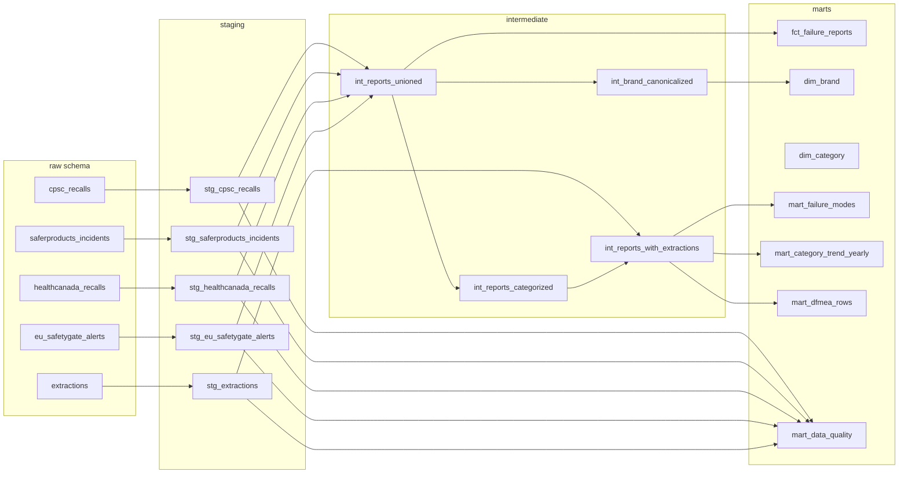

# hindsight-warehouse

A dbt project that turns 13,096 raw product-safety records from four
government feeds into an analyst-ready warehouse. Built to practise the SQL /
dbt / Snowflake / Python pieces of a Forward Deployed Engineer role.

[**Companion app ->**](https://hindsight.mayank-goel.com) the search UI the
same data powers.

## What problem this solves

A mechanical engineer at a small-appliance company needs to answer: *"Before
we design the next pressure cooker lid, what has gone wrong with lids across
every brand on the market?"* The raw data lives in four public feeds with
different schemas and quality bars:

| Feed                        | Shape                     | Trust level                |
|-----------------------------|---------------------------|----------------------------|
| CPSC Recalls API            | nested JSON per recall    | Verified regulator action  |
| SaferProducts.gov incidents | CSV of consumer reports   | **Unverified** consumer claims |
| Health Canada Open Data     | JSON per recall           | Verified regulator action  |
| EU Safety Gate alerts       | weekly XML -> JSON        | Verified regulator action  |

This warehouse unifies them, canonicalises brands, attaches the
LLM-extracted failure mode / cause / effect for each record, and lands them
in three analytics marts: **failure modes**, **category trends**, and
**DFMEA-ready rows**.

## How it's wired up

```
                         +------------------+
     data/raw/*.json ->  |  scripts/load_   | -> raw.cpsc_recalls
                         |  raw.py          |    raw.saferproducts_incidents
                         +------------------+    raw.healthcanada_recalls
                                  |              raw.eu_safetygate_alerts
                                  v              raw.extractions
                         +------------------+    raw.hindsight_version
                         |    staging/      |
                         |  one view per    |
                         |  source, typed   |
                         +------------------+
                                  |
                                  v
                         +------------------+
                         |  intermediate/   |
                         |  union, explode  |
                         |  categories,     |
                         |  canonicalise    |
                         |  brands          |
                         +------------------+
                                  |
                                  v
                         +------------------+
                         |     marts/       |
                         |                  |
                         |  fct_failure_    |
                         |    reports       |   <- incremental on event_date
                         |  dim_brand       |
                         |  dim_category    |
                         |  dim_date        |
                         |  mart_failure_   |
                         |    modes         |
                         |  mart_category_  |
                         |    trend_yearly  |
                         |  mart_dfmea_rows |
                         |  mart_data_      |
                         |    quality       |
                         +------------------+
```



## Real numbers from this build

Ran `dbt build --full-refresh` against DuckDB on **2026-11-11**.

- **18 models** -- 6 staging, 4 intermediate, 8 marts
- **92 data tests** -- all pass (plus 20 schema-generated accepted-values /
  relationships / uniqueness tests, 112 tests total)
- **13,096 records** land in `fct_failure_reports` -- 445 CPSC recalls, 355
  Health Canada recalls, 548 EU Safety Gate alerts, 11,748 SaferProducts.gov
  incident reports
- **103 (category, failure_mode) buckets** in `mart_failure_modes`
- **5,262 DFMEA-ready rows** (records in Ninja v1 scope with an
  LLM-extracted failure mode)
- **99.88% quote support rate** -- every LLM-extracted failure mode is
  grounded in a verbatim quote found in the source text

### Top 10 failure modes by risk score (verified weight x2, serious x3)

| category               | failure mode                        | recalls | unverified | injuries | risk |
|------------------------|-------------------------------------|---------|------------|----------|------|
| coffee_maker           | hot_liquid_or_steam_ejection        | 6       | 285        | 44       | 140  |
| pressure_multi_cooker  | lid_opens_under_pressure            | 5       | 33         | 21       | 91   |
| blender_food_processor | laceration_during_handling_cleaning | 4       | 95         | 40       | 87   |
| grill                  | gas_leak_or_malfunction             | 13      | 230        | 19       | 75   |
| blender_food_processor | unexpected_activation               | 2       | 79         | 28       | 74   |
| blender_food_processor | blade_detachment_or_breakage        | 11      | 369        | 29       | 66   |
| grill                  | fire_or_flare_up                    | 14      | 271        | 11       | 63   |
| pressure_multi_cooker  | overpressure_rupture_explosion      | 0       | 32         | 14       | 53   |
| kettle                 | scald_from_hot_water                | 11      | 37         | 10       | 53   |
| air_fryer              | overheating_fire                    | 7       | 123        | 18       | 48   |

## How to run it

### DuckDB (no cloud account needed)

```bash
uv venv --python 3.12 .venv
uv pip install --python .venv/bin/python -r requirements.txt
.venv/bin/python scripts/load_raw.py --target duckdb
DBT_PROFILES_DIR=. .venv/bin/dbt build
```

`dbt build` seeds, runs 18 models, and executes 112 data tests end-to-end in
under two seconds. The resulting warehouse is a single
`hindsight_warehouse.duckdb` file you can point any BI tool at.

To browse the lineage graph and column docs:

```bash
DBT_PROFILES_DIR=. .venv/bin/dbt docs generate
DBT_PROFILES_DIR=. .venv/bin/dbt docs serve   # then http://localhost:8080
```

### Snowflake

1. Create a database, warehouse, and schemas by pasting
   `scripts/snowflake_setup.sql` into a Snowsight worksheet (or running it
   via the CLI). Takes under 30 seconds.
2. In Snowsight, create a **Programmatic Access Token** under your user menu
   -> *Account* -> *Programmatic access tokens*.
3. Copy `.env.example` to `.env` and fill in `SNOWFLAKE_ACCOUNT`,
   `SNOWFLAKE_USER`, `SNOWFLAKE_TOKEN`. (Keep `.env` out of git; it is
   gitignored.)
4. Load and build:

```bash
source .env
.venv/bin/python scripts/load_raw.py --target snowflake
DBT_PROFILES_DIR=. .venv/bin/dbt build --target snowflake
```

The same SQL runs on both targets. Cross-warehouse joins and JSON access live
in `macros/json_access.sql` and `macros/brand_sig.sql`.

## What the tests guard

Beyond generic uniqueness / not-null / accepted-values tests on keys and
enums, there are five singular tests that encode the data contract:

| Test                              | What it checks                                                                                      |
|-----------------------------------|-----------------------------------------------------------------------------------------------------|
| `assert_quote_support_rate`       | >= 99% of LLM extractions carry a quote found in the source text                                    |
| `assert_cpsc_recalls_have_url`    | Every CPSC recall row has a public URL -- otherwise an engineer can't verify it                     |
| `assert_counts_within_tolerance`  | Per-source row counts land within +/- 5% of the counts hindsight's own `version.json` reports       |
| `assert_no_future_dates`          | No event is dated more than 7 days in the future                                                    |
| `assert_fct_matches_staging`      | `fct_failure_reports` row count equals `int_reports_unioned` -- no fan-out from the brand/extraction join |

## Limits (read before pitching)

- **Unverified reports are unverified.** 11,748 of the 13,096 records are
  SaferProducts.gov consumer submissions. Every mart row that ultimately
  derives from them carries `is_verified = false`. Don't treat them as
  regulator-confirmed failures.
- **Scope is Ninja v1 categories.** The LLM extractor's failure-mode
  taxonomy only covers eight small-appliance categories (pressure cookers,
  air fryers, blenders, ice cream makers, coffee makers, kettles, toaster
  ovens, grills). Rows outside that scope get `is_v1_scope = false` and
  don't appear in `mart_failure_modes` or `mart_dfmea_rows`.
- **EU feed is 2020-mid onwards.** The EU Safety Gate crawl in the source
  project did not complete for weeks before mid-2020.
- **Brand canonicalisation is coarse.** 2,522 of 13,096 rows map to a
  canonical brand via the seed; the rest fall back to their cleaned
  signature (lowercase, suffix-stripped). `is_canonical` flags which is
  which.
- **Snowflake connection uses password auth with a programmatic access
  token.** For anything shared with other engineers, prefer key-pair auth
  (swap the `password` / `authenticator` lines in `profiles.yml` for
  `private_key_path`).
- **Raw data is pinned.** The loader reads the JSON files committed to
  `data/raw/`; it doesn't refresh from the regulators. Refresh is a job for
  the upstream hindsight pipeline, not this warehouse.

## Where things live

```
hindsight-warehouse/
+-- dbt_project.yml          dbt config, materialisation policy per layer
+-- profiles.yml             duckdb (default) and snowflake targets
+-- packages.yml             dbt_utils dependency
+-- requirements.txt         pinned python deps for uv
+-- .env.example             snowflake env var template -- never commit .env
+-- scripts/
|   +-- load_raw.py          same loader for duckdb + snowflake
|   +-- snowflake_setup.sql  CREATE DATABASE/WAREHOUSE/SCHEMAS
+-- data/raw/                six source JSON files, ~22 MB
+-- seeds/
|   +-- brand_aliases.csv    54 alias -> canonical brand mappings
|   +-- category_labels.csv  12 category keys with labels + family
+-- macros/
|   +-- json_access.sql      cross-warehouse JSON/date macros
|   +-- brand_sig.sql        brand signature computation (both warehouses)
+-- models/
|   +-- staging/             6 views, one per source
|   +-- intermediate/        4 views: union, explode, join, canonicalise
|   +-- marts/               8 tables (incl. one incremental fact)
+-- tests/                   5 singular tests
+-- docs/INTERVIEW-NOTES.md  plain-English walk-through
+-- .github/workflows/dbt-build.yml   CI runs `dbt build` on every push
```

## Credits

Source data comes from four public feeds pulled by
[`hindsight`](https://github.com/mayankgoel214/hindsight) on 2026-10-28.
CPSC, SaferProducts.gov and Health Canada are public-domain US/Canada
government records; EU Safety Gate alerts are reusable under
[Commission Decision 2011/833/EU](https://eur-lex.europa.eu/legal-content/EN/TXT/?uri=CELEX%3A32011D0833).
Brand canonicalisation seed is ported from
[`scripts/lib/canon.mjs`](https://github.com/mayankgoel214/hindsight/blob/main/scripts/lib/canon.mjs)
in the source repo.
